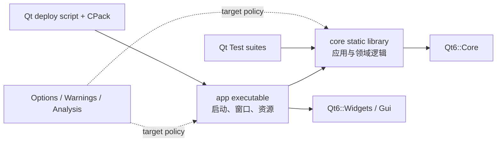

# Architecture

## 目标

这个模板采用“小型模块化单体”作为起点：部署仍是一个桌面应用，但代码从第一天就有明确边界。它避免过早引入插件框架、服务定位器或重量级依赖注入容器，同时保留按产品增长拆分模块的空间。



依赖只允许从外层指向内层。`core` 不可以链接 `Qt6::Widgets`，也不可以 include `MainWindow` 或生成的 UI 头文件。

## 模块职责

### `src/core`

- 可复用、可单测的应用规则与服务。
- 当前的 `ApplicationInfo` 展示了构建期配置如何通过生成头文件进入运行时。
- 公共头文件放在 `include/app/...`，实现文件保持在 target 内部。
- 如果未来核心逻辑可以完全脱离 Qt，优先将值对象改为标准库类型，并在 app 边界转换。

### `src/app`

- 创建 `QApplication`、解析进程参数和组装顶层窗口。
- 保存窗口状态、绑定菜单动作、加载资源。
- `.ui`、图标、样式和未来翻译目录属于这一层。
- 避免把数据库、网络或领域判断直接写入 QWidget 子类。

### `tests`

- 每个测试可执行文件是独立 CTest test，便于并行与按 label 运行。
- 单元测试链接核心 target，而不是复制生产源文件。
- GUI 测试应单独标记 `gui`，CI 中设置 `QT_QPA_PLATFORM=offscreen`；涉及真实窗口系统的测试应进入专门的集成测试阶段。

## 增加一个模块

新增 `src/catalog` 时，建议使用以下结构：

```text
src/catalog/
├── CMakeLists.txt
├── include/app/catalog/CatalogService.hpp
└── CatalogService.cpp
```

对应 target 应显式声明源码、公共头文件与依赖：

```cmake
add_library(qtapp_catalog STATIC)
add_library(${PROJECT_NAME}::Catalog ALIAS qtapp_catalog)

target_sources(qtapp_catalog
    PRIVATE CatalogService.cpp
    PUBLIC
        FILE_SET public_headers
        TYPE HEADERS
        BASE_DIRS include
        FILES include/app/catalog/CatalogService.hpp
)

target_link_libraries(qtapp_catalog
    PUBLIC Qt6::Core
    PRIVATE ${PROJECT_NAME}::Options ${PROJECT_NAME}::Warnings
)
```

随后在 `src/CMakeLists.txt` 添加子目录，并让真正需要它的 target 链接 `${PROJECT_NAME}::Catalog`。

## 配置与持久化

- 编译期元数据由 `ProjectConfig.hpp.in` 生成；不要在多处复制版本号和组织标识。
- 用户首选项使用 `QSettings`，key 按组件分组并保持向后兼容。
- 密钥、token 和密码不得存入 `QSettings` 明文；接入操作系统凭据库并通过接口封装。
- 环境相关路径只进入 `CMakeUserPresets.json` 或 CI 环境，不进入共享 preset。

## 部署边界

`install(TARGETS)` 定义产品安装树，`qt_generate_deploy_app_script()` 收集 Qt 运行时，CPack 将该安装树封装。增加第三方 DLL、许可证或数据文件时，应通过额外的 `install()` 规则加入同一安装模型，而不是编写独立复制脚本。Windows/MSVC 正式安装器还必须链式安装微软官方 Visual C++ Redistributable；Qt 官方不建议分发从开发机收集的单个 MSVC Runtime DLL。

若项目切换到 Qt Quick，需要把 Widgets app target 替换为 `qt_add_qml_module()`，并将部署函数改为 `qt_generate_deploy_qml_app_script()`。
